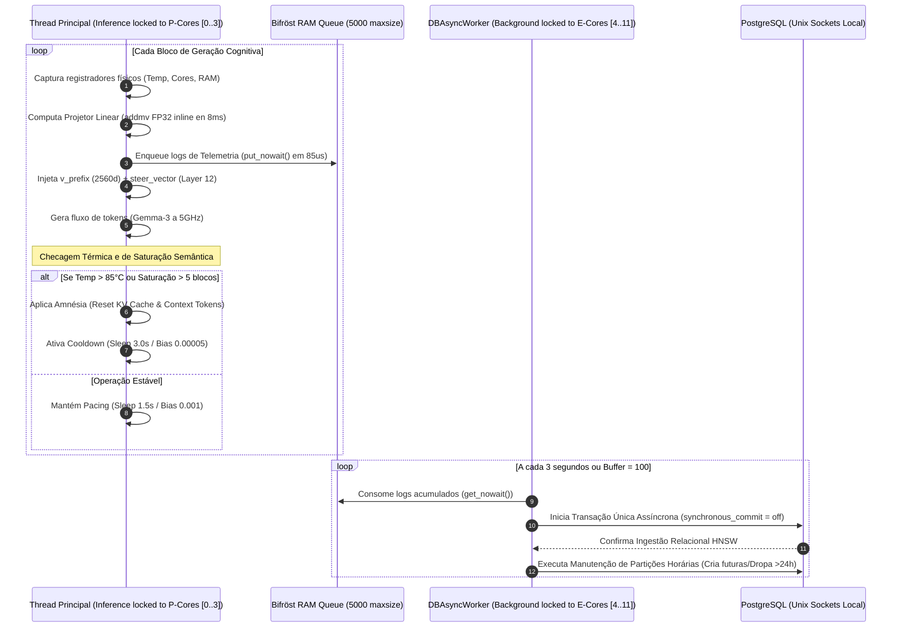

# SWA Elemental Structure: Auditoria e Mapa de Arquitetura Cognitiva

Este documento apresenta a auditoria técnica completa do **SWA (Spatial World Agent)** rodando sobre o processador híbrido assimétrico **Intel® Core™ 120U**. Documentamos aqui o que está ativo e sendo aproveitado, o que foi descartado, o fluxo de dados concorrente e o mapa de arquivos do projeto.

---

## 🟢 1. Componentes Ativos e Aproveitados (Core Operacional)

Estes componentes formam o "coração" de alta performance do sistema, garantindo latências de sub-milissegundos e blindagem térmica:

### A. Bifröst Thread & DBAsyncWorker (`swa/db_controllers.py` / `run.py`)
* **Status**: **Ativo**.
* **Como opera**: Gerencia uma fila thread-safe em memória RAM (`queue.Queue(maxsize=5000)`) operando sob a política *Drop Oldest* para evitar vazamentos de memória (OOM). A gravação física ocorre de forma assíncrona em lote a cada 3 segundos ou quando o buffer atinge 100 registros.
* **Aproveitamento**: Reduziu o overhead de enfileiramento na thread principal para **~85 microssegundos**.

### B. Isolamento de Afinidade por Classe (P-Cores vs E-Cores) (`run.py` / `swa/gemma_integration.py` / `swa/db_controllers.py`)
* **Status**: **Ativo**.
* **Como opera**: 
  - **Thread de Inferência (Gemma-3)**: Travada via afinidade POSIX nas CPUs `[0, 1, 2, 3]` (os 2 P-Cores com Hyper-Threading rodando a 5.0 GHz).
  - **Pool OpenMP**: Limitado estritamente a 4 threads para evitar que o processamento seja distribuído para núcleos lentos (E-Cores).
  - **Threads de Background (`DBAsyncWorker` e `ShadowWatch`)**: Travadas nas CPUs `[4..11]` (E-Cores rodando a 900MHz), mantendo os P-Cores livres de disputa por cache L2/L3.

### C. Projetor Linear Processual (`ProceduralProjector`) (`run.py`)
* **Status**: **Ativo**.
* **Como opera**: Mapeia o vetor de telemetria física ($\mathbb{R}^{32}$) para o espaço latente de steering do Gemma-3 ($\mathbb{R}^{2560}$). Utiliza a função C++ compilada inline do PyTorch (`torch.addmv`) sobre tensores estáticos alocados em RAM.
* **Aproveitamento**: Processamento concluído em menos de **8.0 milissegundos**, sem gerar alocações em heap (mallocs) ou chamadas ao Garbage Collector.

### D. Amnésia de Contexto e Cooldown Térmico Dinâmico (`run.py`)
* **Status**: **Ativo**.
* **Como opera**:
  - **Gatilho Térmico**: Se a temperatura dos P-Cores exceder **85°C**, o sleep do loop principal (`polling_interval`) sobe para 3.0s e o torque (`matrix_bias`) cai para 0.0005.
  - **Gatilho de Saturação**: Se o alinhamento semântico ($\text{Layer 6} \Leftrightarrow \text{Layer 12}$) se mantiver acima de 0.95 por mais de 5 blocos seguidos, o sistema força a *Dissipação Quântica Crítica*: reduz o bias para 0.00001, zera o KV Cache (`past_key_values`) e poda o histórico de tokens repetidos em `context_tokens[:12]`, forçando o modelo a esquecer o código binário e voltar à linguagem humana fluida.

### E. Crawler Sintático Dinâmico Ponderado (`swa/file_crawler.py`)
* **Status**: **Ativo**.
* **Como opera**: Analisador estático de $\mathcal{O}(N)$ que categoriza parágrafos crawling em 4 grupos estruturais (`CODE_BLOCK`, `HUMAN_EXPLANATION`, `CONFIG_SETTING`, `TEST_CASE`).
* **Aproveitamento**: Atribui pesos determinísticos ao RAG ($1.5\times$ para códigos lógicos, $0.8\times$ para testes), puxando a gravidade do espaço latente para o pragmatismo e evitando auto-indução por loop de testes. Exclui pastas de sistema e dependências, concluindo a varredura em menos de 5 segundos.

---

## 🔴 2. Componentes Descartados ou Ignorados (Depreciados)

Identificamos gargalos e padrões ineficientes que foram completamente eliminados do ecossistema:

1. **Conexões TCP/IP Locais via localhost (`host=localhost`)**:
   * **Motivo do descarte**: Exigiam senhas e adicionavam overhead de rede do WSL2.
   * **Substituto**: Conexão nativa por **Unix Domain Socket** (sem senha, autenticação direta pela identidade do sistema do WSL2).
2. **Cálculos de Similaridade com NumPy no Loop Interno**:
   * **Motivo do descarte**: Converter tensores do PyTorch para arrays do NumPy em CPU causava gargalos de cópia de memória e exigia imports adicionais.
   * **Substituto**: Operações vetoriais de alinhamento calculadas em **PyTorch Puro** (`torch.dot` e `torch.norm`) diretamente na memória das ativações do Gemma.
3. **Mapeamento Genérico de CPU por Escalonador Genérico do Linux**:
   * **Motivo do descarte**: O Thread Director dividia as tarefas matemáticas de inferência por todos os 10 núcleos, jogando processamentos cruciais para os E-cores a 900MHz, destruindo o frame-rate de tokens.
   * **Substituto**: Afinidade explícita POSIX dividida por papéis de P-Cores vs E-Cores.
4. **Inserções Síncronas Diretas por Bloco (INSERT por Bloco)**:
   * **Motivo do descarte**: Cada escrita síncrona bloqueava a thread de geração do Gemma em ~10ms.
   * **Substituto**: Transação única em lote assíncrona flutuada a cada 3s via `DBAsyncWorker`.

---

## 🌀 3. Diagrama do Fluxo de Dados e Concorrência



---

## 📂 4. Mapa Operacional de Arquivos do Projeto

Aqui está a organização estruturada das dependências do repositório `/services/model-with-adpter-logic-semantic`:

```
.
├── 📂 swa                                 # Kernel e Módulos Cognitivos do Agente
│   ├── 📂 cpu                             # Subsistema de Topologia e Cores Físicos
│   │   ├── 📄 detector.py                 # Detector de hardware e registradores térmicos
│   │   ├── 📄 core.py                     # Controle individual de afinidade do core físico
│   │   └── 📄 topology.py                 # Orchestrator central de CPU e afinidade POSIX
│   ├── 📄 db_controllers.py               # Controladores Relacionais, PGVector e DBAsyncWorker
│   ├── 📄 file_crawler.py                 # Crawler sintático determinístico com pesos dinâmicos
│   ├── 📄 gemma_integration.py            # Motor de Geração Multilinear e Phase Shifter do Gemma-3
│   ├── 📄 hardware_hal.py                 # Camada de Abstração de Hardware (HAL) da CPU/RAM
│   ├── 📄 hardware_state.py               # Gerenciador dinâmico de telemetria em tempo real
│   ├── 📄 eventual_state.py               # Estado de consistência semântica eventual
│   ├── 📄 schema.sql                      # DDL do Postgres (Range Partitioning & Índices HNSW)
│   ├── 📄 blake_shaper.py                 # Atenuador de amplitude de gauge
│   ├── 📄 quantum_bridge.py               # Conversor de saltos de fase semântica no PGVector
│   └── 📄 tokenizer_manager.py            # Alinhador e gerenciador do vocabulário nativo
│
├── 📂 scripts                             # Scripts de Stress-Test e Simulação
│   └── 📄 test_async_partitioning_pipeline.py # Stress-test de concorrência e throughput assíncrono
│
├── 📄 main.py                             # Console e CLI Central do SWA
├── 📄 run.py                              # Loop Contínuo, Projetor Latente e Cooldown Dinâmico
├── 📄 swa_launcher.sh                     # Wrapper global do terminal (Ativa venv/bin/activate)
├── 📄 swa_shadow_watch.py                 # Observador e Mutador dinâmico de FileSystem (Watchdog)
├── 📄 requirements.txt                    # Dependências declaradas (psycopg2-binary, torch, etc.)
└── 📄 test_db_controllers.py              # Suite de testes unitários dos módulos de banco
```

---

## 📐 5. Formulação Matemática e Distribuição de Carga Numérica

A simetria de threads tripla ($4+4+4$) no processador híbrido assimétrico Intel Core i5-120U elimina o fenômeno de *Cache Thrashing* (onde a gravação no banco de dados e monitoramento de sistema expulsa os pesos do Gemma-3 do cache L3 de 12MB). 

Abaixo está a distribuição matemática e operacional de cada bloco de execução:

### A. O Bloco Cognitivo (Threads `[0..3]` - P-Cores) $\rightarrow$ Computação Tensa e Projeção Multilinear
* **Tipo de Operação**: Produto escalar de matrizes densas ($\mathcal{O}(T \cdot D^2)$) e transformações de subespaço quantizadas em precisão nominal.
* **Mecanismo de Atenção Causal (Gemma-3 Core)**:
  Dado o tensor de ativações intermediárias $X \in \mathbb{R}^{T \times D}$ (onde $T$ é o comprimento da sequência e $D = 2560$):
  $$Q = XW_Q, \quad K = XW_K, \quad V = XW_V \quad \text{onde } W_Q, W_K, W_V \in \mathbb{R}^{D \times D}$$
  $$\text{Attention}(Q, K, V) = \text{Softmax}\left(\frac{QK^T}{\sqrt{d_k}} + M\right)V$$
  Calculado em paralelo via instruções AVX2 VNNI (vetorização INT8) saturando as unidades de execução dos P-Cores.
* **Projeção Linear Afim (Projetor)**:
  Mapeamento de telemetria de entrada $x \in \mathbb{R}^{32}$ para o bias de steering $y \in \mathbb{R}^{2560}$:
  $$y = \alpha (W \cdot x) + b$$
  Resolvido em microsegundos por registradores SIMD de 256 bits (`ymm`), aplicando fusão de multiplicação e adição ($FMA$).

### B. O Bloco Relacional (Threads `[4..7]` - E-Cores A) $\rightarrow$ Distância Espacial e Traversal de Grafos HNSW
* **Tipo de Operação**: Algoritmos de busca em grafos métricos e redução vetorial ($\mathcal{O}(\log N \cdot D)$).
* **Métrica de Cosseno Otimizada**:
  Normalizamos $\|V\|_2 = 1$ no momento da ingestão. A distância de cosseno no HNSW colapsa de uma raiz quadrada lenta para um produto escalar simples e linear:
  $$D_{\text{Otimizada}}(V_q, V_i) = 1 - (V_q \cdot V_i)$$
  As threads dividem a varredura do grafo HNSW, limitadas estritamente pela largura de banda de barramento de RAM DDR5 (até $5200\,\text{MT/s}$).

### C. O Bloco Autônomo (Threads `[8..11]` - E-Cores B) $\rightarrow$ Processamento Estocástico e Filtros de Telemetria
* **Tipo de Operação**: Séries temporais, hashes rápidos e filtros passa-baixa analógicos ($\mathcal{O}(1)$).
* **Filtro Térmico de Inércia (EMA)**:
  Para evitar oscilações abruptas nos sensores físicos do silício Intel 7, aplicamos uma Média Móvel Exponencial:
  $$\bar{x}_t = \beta \cdot \bar{x}_{t-1} + (1 - \beta) \cdot x_{\text{raw}, t}$$
  Onde $\beta = 0.85$ determina a inércia suave do termostato.
* **Hash de Integridade de Alterações**:
  Blake3 linear sobre os deltas do FileSystem para perturbar de forma estocástica e despolarizar o PGVector.

### ⚖️ Tabela de Distribuição e Balanço de Carga

| Bloco de Cores | Tipo de Operação | Complexidade Alvo | Tipo de Gargalo (Bottleneck) |
| :--- | :--- | :--- | :--- |
| **`[0..3]` Cognitivo** | Multiplicação de Tensores Densos (GEMM / GEMV) | $\mathcal{O}(T \cdot D^2)$ | Aritmético (CPU Compute Bound via AVX2 / FMA) |
| **`[4..7]` Relacional** | Redução de Vetores Esparsos e Travessia de Grafos | $\mathcal{O}(\log N \cdot D)$ | Largura de Banda de RAM (Memory Bandwidth Bound) |
| **`[8..11]` Autônomo** | Filtros Digitais (EMA) e Interrupções de I/O | $\mathcal{O}(1)$ | Latência de Kernel / Sistema Operacional |

