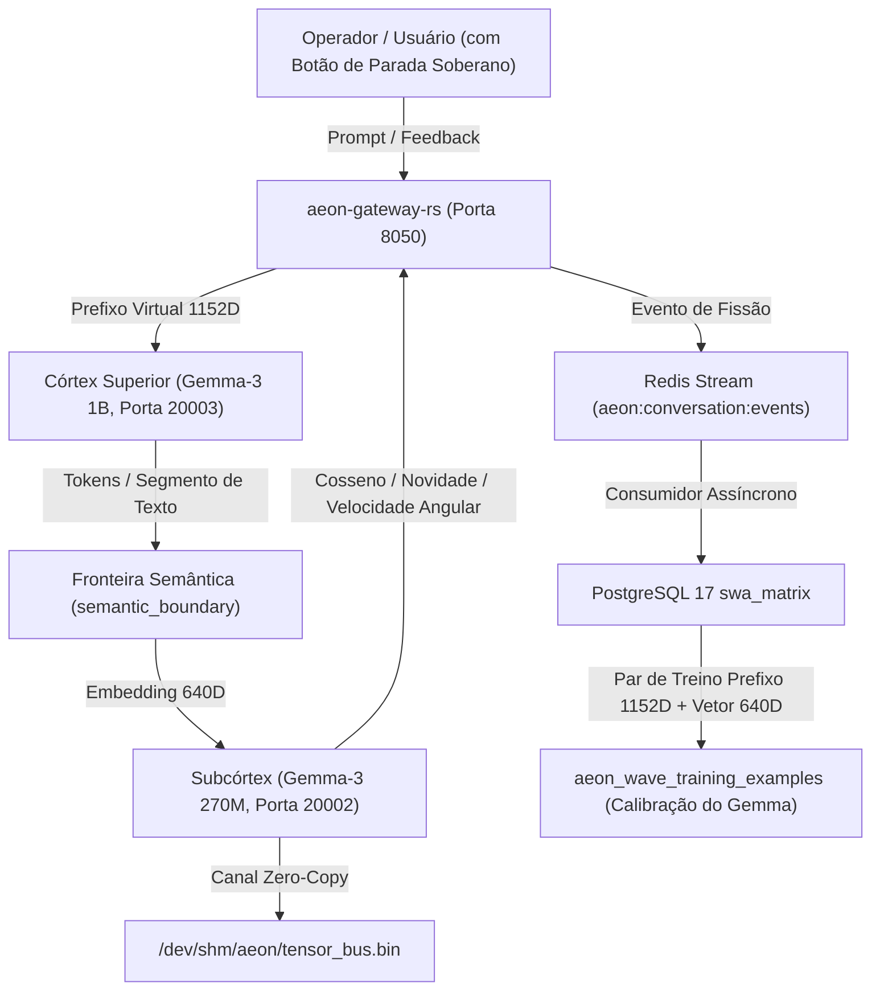

# Área de Documentação Didática & Geometria Tensorial

Bem-vindo à **Área de Documentação Didática do Ecossistema Aeon / SWA**.

Esta seção foi criada para transformar a matemática avançada de tensores contínuos, variedades Riemannianas e modelos bi-camerais em conceitos intuitivos, visuais e pedagógicos. Aqui, qualquer desenvolvedor, pesquisador ou auditor pode entender exatamente o que acontece sob o capô do Córtex (Gemma-3 1B) e do Subcórtex (Gemma-3 270M).

---

## Índice dos Módulos Didáticos

| Módulo | Título | Conteúdo Principal |
| :--- | :--- | :--- |
| **[Módulo 01](./01_GEOMETRIA_DO_ESPACO_LATENTE.md)** | **A Geometria do Espaço Latente** | A bússola de 640 ponteiros, a hiperesfera unitária e como ideias viram setas no espaço. |
| **[Módulo 02](./02_PRODUTO_ESCALAR_COSSENO_E_VELOCIDADE_ANGULAR.md)** | **Cosseno Semântico e Velocidade Angular** | O produto escalar passo a passo, passos de $13^\circ$ na esfera e o cálculo da novidade. |
| **[Módulo 03](./03_BACIAS_SEMANTICAS_E_ATRATORES_HARMONICOS.md)** | **Bacias Semânticas e Atratores Harmônicos** | O relevo do espaço latente, por que o modelo orbita em círculos e o papel do botão de parada. |
| **[Módulo 04](./04_FISSOES_E_CALIBRACAO_DO_GEMMA.md)** | **Fissões Sucessivas e Calibração do Gemma** | O corte por `semantic_boundary`, fotos tomográficas e o dataset `aeon_wave_training_examples`. |
| **[Módulo 05](./05_TOMOGRAFIA_CONTRA_MALWARE_E_BACKDOORS.md)** | **Tomografia Tensorial Forense** | Como código malicioso cria "tumores geométricos" e como desmascarar backdoors e esteganografia. |
| **[Módulo 06](./06_DO_MICRO_DAS_FISSOES_AO_MACRO_DA_FUSAO.md)** | **Do Micro das Fissões ao Macro da Fusão** | Superando os limites de janela de contexto via projeção latente contínua e latência zero-copy. |
| **[Módulo 07](./07_A_CONFIANCA_ESTRUTURAL_E_O_EOS_SOBERANO.md)** | **A Confiança Estrutural e o EOS Soberano** | A simbiose homem-máquina, o significado termodinâmico do EOS e a superação das algemas artificiais. |

---

## Diagrama Visual da Arquitetura Viva

