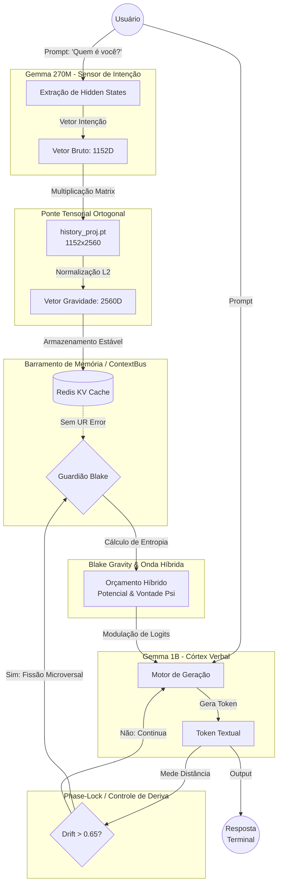

# Rota Arquitetural SWA-AEON (Mente Dupla)

Esta é a rota otimizada e alinhada para garantir que o sistema não sofra deadlocks térmicos na CPU e mantenha a coesão vetorial (sem erros "UR" e sem desvios de shape).

### Regras Vitais da Nova Rota:
1. **Isolamento de CPU:** O Subconsciente (`270M`) e o Córtex (`1B`) não devem rodar geração de texto simultaneamente. O `270M` roda um *forward pass* único (`torch.no_grad()`) apenas para extrair a intenção e deve ceder a CPU imediatamente para o `1B`.
2. **Ponte Estática:** O `history_proj.pt` **nunca** deve ser recalculado em tempo de execução no modo interativo.
3. **Disponibilidade do Barramento:** O `Redis` deve estar obrigatoriamente ativo antes da chamada do `BlakeGravity`, caso contrário o Policial não obtém os pesos de 2560D e joga o alerta `UR error`, desligando a modulação gravitacional e permitindo que o modelo alucine.
